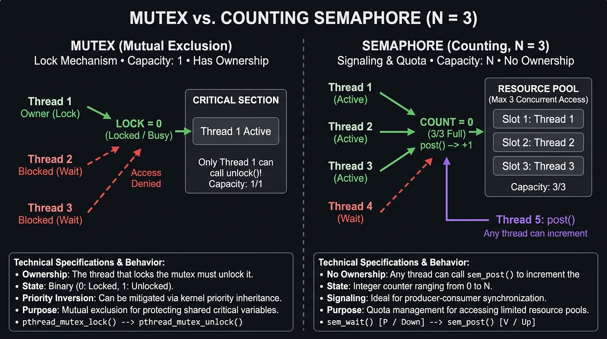

# Mutex vs. Semaphore

> Understanding synchronization primitives, mutual exclusion, resource management, and thread coordination in concurrent systems.

## Table of Contents

- [Introduction](#introduction)
- [Mutex (Mutual Exclusion)](#mutex-mutual-exclusion)
  - [How It Works](#how-it-works)
  - [Ownership](#ownership)
  - [Mutex in C](#mutex-in-c)
  - [Priority Inversion](#priority-inversion)
- [Semaphore](#semaphore)
  - [Binary Semaphore](#binary-semaphore)
  - [Counting Semaphore](#counting-semaphore)
  - [Semaphore in C](#semaphore-in-c)
- [Mutex vs. Semaphore](#mutex-vs-semaphore)
- [Practical Use Cases](#practical-use-cases)
- [Common Mistakes](#common-mistakes)
- [Conclusion](#conclusion)
- [References](#references)

---

## Introduction

In concurrent programming, multiple threads may execute simultaneously and attempt to access shared resources, such as memory locations, files, data structures, or hardware resources.

When multiple threads access and modify shared data without proper synchronization, race conditions can occur. These conditions may lead to inconsistent data, unexpected behavior, and difficult-to-reproduce bugs.

Operating systems and programming environments provide synchronization primitives to coordinate concurrent execution and control access to shared resources.

Two fundamental synchronization mechanisms are **Mutex (Mutual Exclusion)** and **Semaphore**.

Although both are used in concurrent programming, they solve different problems:

- **Mutex:** Provides exclusive access to a shared resource. Only one thread can own the mutex at a time.
- **Semaphore:** Controls access through a counter representing the number of available permits or resources.

Understanding the distinction between these mechanisms is essential when designing concurrent applications and operating system components.

---

## Mutex (Mutual Exclusion)

A mutex is a synchronization primitive used to ensure that only one thread at a time can access a protected critical section.

In concurrent programming, a shared resource or shared variable may be accessed by multiple threads. If multiple threads modify the same resource simultaneously without synchronization, race conditions can occur.

A mutex prevents this by introducing a locking mechanism.

When a thread wants to access a protected resource, it must first acquire the mutex. If the mutex is already locked by another thread, the requesting thread must wait until the mutex becomes available.

Once the thread finishes its operation, it releases the mutex, allowing another waiting thread to acquire it.

### How It Works

A typical mutex operation follows this sequence:

1. Thread 1 attempts to acquire the mutex.
2. The mutex is available, so Thread 1 acquires ownership.
3. Thread 1 enters the critical section and accesses the shared resource.
4. Thread 2 attempts to acquire the same mutex.
5. Since Thread 1 currently owns the mutex, Thread 2 blocks or waits.
6. Thread 1 completes its operation and releases the mutex.
7. Another waiting thread can now acquire the mutex.

This guarantees that the protected critical section is accessed by only one thread at a time.

### Ownership

One of the most important characteristics of a mutex is **ownership**.

A mutex has an owner: the thread that successfully acquired it.

The thread that locks a mutex is responsible for unlocking it after completing its critical section.

This ownership model distinguishes a mutex from a semaphore.

A mutex is not simply a counter or a resource quota. It represents exclusive ownership of a protected section.

### Mutex in C

The POSIX Threads (Pthreads) API provides mutex functionality through `pthread_mutex_t`.

Example:

```c
#include <pthread.h>
#include <stdio.h>


pthread_mutex_t mutex = PTHREAD_MUTEX_INITIALIZER;
int shared_counter = 0;

void *worker(void *arg){

    int threadNumber = (int)(long)arg;
    pthread_mutex_lock(&mutex);
    int initialized_shared_counter = shared_counter;

    for (size_t i = 0; i < 10000; i++){
        shared_counter++;
    }

    printf("Shared counter value from %d to %d for threadNumber: %d\n", initialized_shared_counter, shared_counter, threadNumber);
    pthread_mutex_unlock(&mutex);

    return NULL;
}

int main(void){

    pthread_t t1, t2;

    pthread_create(&t1, NULL, worker, (void*)(long)1);
    pthread_create(&t2, NULL, worker, (void*)(long)2);
    
    pthread_join(t1, NULL);
    pthread_join(t2, NULL);

    pthread_mutex_destroy(&mutex);

    return 0;
}
```

Compile:

```bash
gcc -pthread mutex.c -o mutex
```

Both threads increment the same shared variable. Without synchronization, concurrent modifications could cause lost updates.

By protecting the increment operation with a mutex, only one thread can modify `shared_counter` at a time.

## Demonstrating Race Conditions: Without vs. With Mutex

To understand why mutex synchronization is necessary, consider two threads attempting to increment the same shared counter.

Assume that both threads increment the counter by 10,000. The expected final value is 20,000.

### Without Mutex

When no synchronization mechanism is used, both threads can access and modify the shared counter simultaneously.

**Example output:**

```text
$ ./mutex
Shared counter value from 0 to 10000 for threadNumber: 1
Shared counter value from 7528 to 17528 for threadNumber: 2
```

As shown in the output, Thread 2 starts its operation when the shared counter has already reached 7,528 instead of 10,000.

This happens because the execution of the two threads overlaps. Their operations are not properly synchronized, resulting in an unexpected counter value.

The expected final value is 20,000, but the actual result is 17,528.

This is an example of a **race condition**, where the program's result depends on the timing and interleaving of concurrent operations.

### With Mutex

Now, let's protect the shared counter using a mutex.

Each thread must acquire the mutex before accessing the shared counter and release it after completing its operation.

**Example output:**

```text
$ gcc -pthread mutex.c -o mutex
$ ./mutex
Shared counter value from 0 to 10000 for threadNumber: 1
Shared counter value from 10000 to 20000 for threadNumber: 2
```

This time, Thread 2 waits until Thread 1 releases the mutex.

As a result, each thread executes its critical section exclusively, and the shared counter is updated correctly.

The final value is now 20,000, as expected.

### Comparison

| Without Mutex | With Mutex |
|---|---|
| Concurrent access to shared data | Exclusive access to shared data |
| Race conditions may occur | Protected critical section |
| Unexpected results possible | Consistent result |
| No synchronization guarantee | Mutual exclusion enforced |

**Key Takeaway:** A mutex does not prevent threads from executing concurrently. Instead, it ensures that access to a particular critical section is serialized, preventing multiple threads from modifying the protected shared resource simultaneously.

*Note: Thread scheduling and execution timing are nondeterministic. Therefore, the exact output and intermediate counter values may vary between executions.*

### Priority Inversion

Priority inversion is a scheduling problem that can occur when threads with different priorities compete for a mutex.

Consider three threads:

- High-priority Thread H
- Medium-priority Thread M
- Low-priority Thread L

A possible scenario:

1. Thread L acquires a mutex.
2. Thread H attempts to acquire the same mutex and blocks.
3. Thread M becomes runnable and preempts Thread L.
4. Thread H cannot proceed until Thread L releases the mutex, but Thread L is prevented from running by Thread M.

As a result, a high-priority thread indirectly waits for a lower-priority thread.

Some operating systems and mutex implementations support **Priority Inheritance**, which temporarily raises the priority of the mutex owner to help it finish its critical section and release the mutex.

---

## Semaphore

A semaphore is a synchronization primitive that uses an integer counter to control access to a resource or coordinate execution between threads.

Unlike a mutex, a counting semaphore does not have ownership semantics.

Any thread that has access to the semaphore can perform a `sem_post()` operation to increment its counter. It does not have to be the thread that previously called `sem_wait()`.

A semaphore is particularly useful when multiple threads are allowed to access a limited number of resources simultaneously.

### How It Works

Consider a parking lot with a maximum capacity of five vehicles.

The parking lot has five available spaces, meaning its initial semaphore value is five.

- Each arriving vehicle must acquire a permit before entering.
- When a vehicle enters, one permit is consumed.
- When all five spaces are occupied, the semaphore counter reaches zero.
- Additional vehicles must wait until a space becomes available.
- When a vehicle leaves, a permit is released.
- A waiting vehicle can then enter.

In this example, the semaphore represents the number of available parking spaces.

This is the fundamental idea behind a counting semaphore.

### Binary Semaphore

A binary semaphore has a counter that is typically restricted to the values 0 and 1.

It can be used for signaling and synchronization between threads.

For example, one thread can notify another thread that a particular operation or task has completed.

A binary semaphore is not equivalent to a mutex, even though both may involve a binary state.

The important distinction is ownership: a mutex has an owner, whereas a semaphore does not.

### Counting Semaphore

A counting semaphore allows its counter to represent multiple available permits.

Its value indicates how many operations can acquire a permit without waiting.

The basic operations are:

- `sem_wait()`: Decrements the semaphore counter. If no permits are available, the calling thread blocks until one becomes available.
- `sem_post()`: Increments the semaphore counter and may wake a waiting thread.

The operations are performed atomically by the synchronization mechanism.

For a semaphore initialized with a value of 3:

| Operation | Counter | Behavior |
|---|---:|---|
| Initial state | 3 | Three available permits |
| Thread 1 calls wait | 2 | Acquires a permit |
| Thread 2 calls wait | 1 | Acquires a permit |
| Thread 3 calls wait | 0 | Acquires a permit |
| Thread 4 calls wait | 0 | Blocks |
| Another thread calls post | 1 | Releases a permit |
| Thread 4 proceeds | 0 | Acquires the available permit |

This mechanism ensures that no more than three threads can hold permits simultaneously, provided every acquisition is correctly paired with a release.

### Semaphore in C

The POSIX semaphore API provides semaphore functionality through `sem_t`.

Example:

```c
#include <pthread.h>
#include <semaphore.h>
#include <stdio.h>
#include <unistd.h>

#define MAX_CONCURRENT_ACCESS 5

sem_t semaphore;

void *worker(void *arg)
{
    int id = *(int *)arg;

    sem_wait(&semaphore);

    printf("Thread %d entered the resource pool\n", id);

    sleep(3);

    printf("Thread %d released its permit\n", id);

    sem_post(&semaphore);

    return NULL;
}

int main(void)
{
    pthread_t threads[10];
    int thread_ids[10];

    sem_init(&semaphore, 0, MAX_CONCURRENT_ACCESS);

    for (int i = 0; i < 10; i++)
    {
        thread_ids[i] = i + 1;

        pthread_create(
            &threads[i],
            NULL,
            worker,
            &thread_ids[i]
        );
    }

    for (int i = 0; i < 10; i++)
    {
        pthread_join(threads[i], NULL);
    }

    sem_destroy(&semaphore);

    return 0;
}
```

Compile:

```bash
gcc -pthread semaphore.c -o semaphore
```

In this example:

- Ten threads are created.
- The semaphore is initialized with five permits.
- At most five threads can hold permits simultaneously.
- Additional threads wait until an existing thread releases its permit.
- `sem_post()` makes a permit available again.

The second argument of `sem_init()` is `pshared`.

When set to `0`, the semaphore is shared between threads of the same process. When set to a nonzero value, it is intended for interprocess sharing and must reside in shared memory.

---

## Mutex vs. Semaphore

Although mutexes and semaphores are both synchronization primitives, their underlying semantics and intended use cases differ.

| Characteristic | Mutex | Semaphore |
|---|---|---|
| Primary purpose | Mutual exclusion | Resource counting and signaling |
| Ownership | Yes | No |
| Counter | Binary lock state | Integer counter |
| Concurrent access | One owner | Up to N permits |
| Unlock / release | Owner releases | Any authorized thread can post |
| Blocking | When already locked | When counter reaches zero |
| Typical use | Protecting shared data | Managing limited resources |
| Priority inheritance | Supported by some implementations | Not generally an equivalent ownership mechanism |

Please review the comprasion picture below about mutex and semaphore.



### Key Differences

**1. Ownership**

A mutex has an ownership model. The thread that acquires the mutex is responsible for releasing it.

A semaphore has no ownership model. Any thread can increment its counter using `sem_post()`.

**2. Resource Management**

A mutex is designed to protect a critical section from concurrent access.

A counting semaphore is designed to manage a limited number of concurrent operations or available resources.

**3. Synchronization**

Mutexes primarily provide mutual exclusion.

Semaphores can also be used for signaling between threads, such as notifying a consumer that data is available.

**4. Concurrency Limits**

A mutex allows only one thread to own the protected lock at a time.

A counting semaphore initialized with N permits can allow up to N threads to acquire permits simultaneously.

---

## Practical Use Cases

### When to Use a Mutex

Mutexes are appropriate when multiple threads need to access or modify shared data, but those operations must be performed exclusively.

Common examples:

- Protecting shared variables and data structures.
- Synchronizing access to shared configuration.
- Protecting critical sections.
- Preventing race conditions in concurrent applications.

### When to Use a Semaphore

Semaphores are useful when the number of concurrent operations must be limited or when threads need to coordinate execution.

Common examples:

- Limiting concurrent database connections.
- Managing a fixed-size resource pool.
- Controlling the number of concurrent file operations.
- Producer-consumer synchronization.
- Signaling task completion between threads.

---

## Common Mistakes

- **Using a semaphore instead of a mutex without considering ownership:** A semaphore does not guarantee that the thread releasing a permit is the one that acquired it.
- **Forgetting to release a mutex:** This can leave other threads blocked indefinitely.
- **Incorrect semaphore accounting:** Calling `sem_post()` more times than intended can increase the available permit count beyond the resource capacity.
- **Assuming a semaphore protects shared data:** A counting semaphore initialized with N does not provide exclusive access when N is greater than one.
- **Ignoring deadlocks:** Incorrect lock ordering and synchronization logic can cause threads to wait indefinitely.
- **Assuming synchronization guarantees fairness:** Neither primitive should automatically be assumed to provide FIFO scheduling or fairness.

---

## Conclusion

Mutexes and semaphores are fundamental building blocks of concurrent programming.

Although they can both block threads and coordinate execution, they serve different purposes.

A mutex is the appropriate choice when a shared resource must be accessed exclusively by one thread at a time.

A semaphore is the appropriate choice when managing a limited number of resources, controlling concurrency, or signaling between threads.

The key distinction is simple:

**Mutex = Ownership and Mutual Exclusion**

**Semaphore = Counter, Permits and Signaling**

Choosing the correct synchronization primitive is essential for building reliable, predictable, and efficient concurrent systems.

---

## References

- [The Open Group — pthread_mutex_lock()](https://pubs.opengroup.org/onlinepubs/9799919799/functions/pthread_mutex_lock.html)
- [The Open Group — sem_wait()](https://pubs.opengroup.org/onlinepubs/9799919799/functions/sem_wait.html)
- [The Open Group — sem_post()](https://pubs.opengroup.org/onlinepubs/9799919799/functions/sem_post.html)
- [Linux man-pages — pthread_mutex(3)](https://man7.org/linux/man-pages/man3/pthread_mutex_lock.3.html)
- [Linux man-pages — sem_overview(7)](https://man7.org/linux/man-pages/man7/sem_overview.7.html)
- [Linux man-pages — sem_init(3)](https://man7.org/linux/man-pages/man3/sem_init.3.html)