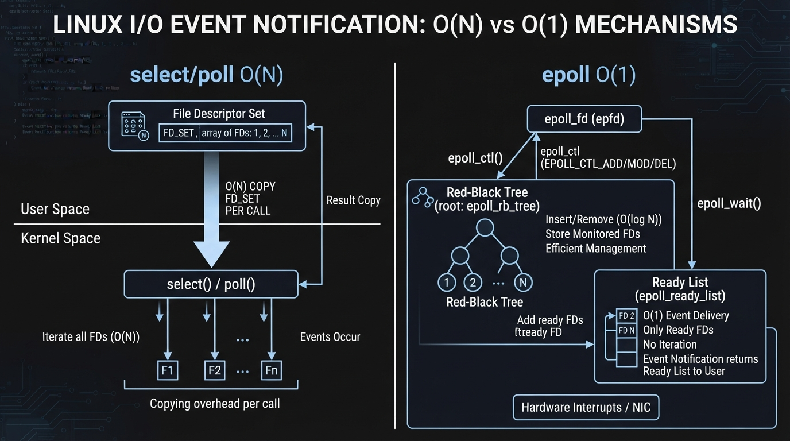
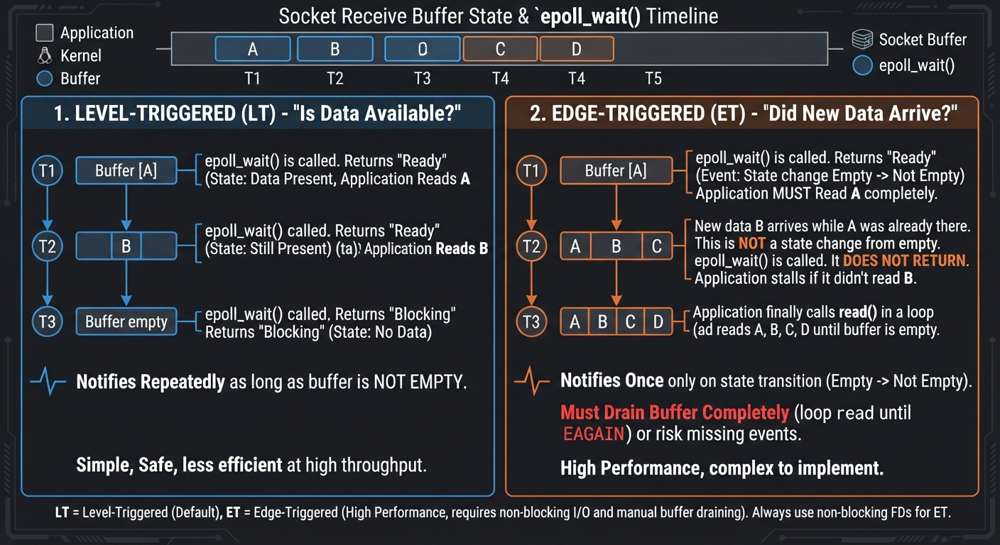

# Under the Hood of Linux `epoll`: Why Threads, `select`, and `poll` Hit a Wall

In the early 2000s, the rapid expansion of the internet forced systems engineers to confront a notorious architectural bottleneck known as the **C10K problem**—the challenge of optimizing network sockets so a single server could handle 10,000 concurrent connections simultaneously. Before event-driven architectures became standard, engineers tried scaling servers using multi-threading and early I/O multiplexing system calls like `select()` and `poll()`. However, each of these approaches crumbled under heavy concurrency due to memory overhead, context-switching penalties, and $O(N)$ kernel bottlenecks. To overcome these fundamental limits, Davide Libenzi introduced **`epoll`** in 2002 (Linux kernel 2.5.44), providing a scalable, event-driven I/O notification mechanism that became the backbone of modern high-performance software such as Nginx, Redis, and Node.js.

## 1. The First Attempt: One Thread Per Connection

Before I/O multiplexing became dominant, the most intuitive way to handle multiple clients simultaneously was the **thread-per-connection** (or process-per-connection) model, famously used by early versions of the Apache HTTP Server. In this architecture, the main thread blocks on `accept()`, and every time a new client connects, the server spawns a dedicated OS thread to handle that client's blocking `read()` and `write()` calls until the connection closes.

While easy to reason about, this model fails dramatically when scaled to thousands of concurrent connections due to two major resource bottlenecks:

* **Memory Exhaustion from Thread Stacks:** On Linux, each OS thread allocates a default virtual stack size (typically **8 MB** unless manually tuned down), along with kernel-space thread structures (`task_struct`). Spawning 10,000 threads immediately consumes gigabytes of virtual address space and substantial physical RAM just to keep idle connections alive.
* **Context-Switching Overhead:** The Linux scheduler has to constantly switch CPU cores between thousands of threads as network packets trickle in. Every context switch requires saving and restoring CPU registers, flushing TLBs (Translation Lookaside Buffers), and invalidating CPU caches—causing the server to spend more CPU time managing threads than actually processing network data.

## 2. Why `select()` and `poll()` Failed at Scale

To escape the memory and context-switching penalties of spawning thousands of threads, engineers turned to **I/O multiplexing** with `select()` and `poll()`. Both system calls allow a single thread to monitor multiple file descriptors (FDs) at once to determine whether any of them are ready for reading or writing. While this eliminated per-connection threads, both system calls introduced severe algorithmic bottlenecks when scaled up to tens of thousands of predominantly idle connections.

### Repeated User-to-Kernel Space Memory Copying

Every time an application invokes `select()` or `poll()`, it must pass the entire list of monitored file descriptors from **User Space** into **Kernel Space**. If a server is tracking 50,000 open sockets, the operating system has to copy that entire array of descriptors across the user/kernel boundary on every single iteration of the event loop, even if 49,998 of those sockets have had zero network activity. Once the kernel finishes checking the sockets, it copies the modified structures back to user space, wasting substantial memory bandwidth and CPU cycles on redundant data transfers.

### Linear Scanning and $O(N)$ Complexity

Because `select()` and `poll()` are stateless across invocations, the kernel retains no memory of which file descriptors were monitored during the previous call. Each time the system call is entered, the kernel must linearly iterate through every single file descriptor ($O(N)$) to inspect its current status and attach the calling thread to each socket's wait queue. Worse yet, when network packets finally arrive and `select()` or `poll()` wakes up, the kernel does not return a compact list of the ready sockets. Instead, the user-space application is forced to loop through all 50,000 file descriptors *again* ($O(N)$) just to discover which two or three sockets actually received data.

### Hardcoded Limits in `select()`

Beyond algorithmic complexity, `select()` imposes a strict structural ceiling by relying on a fixed-size bitmask (`fd_set`), which is typically hardcoded to `FD_SETSIZE = 1024` on Linux systems. Monitoring more than 1,024 concurrent file descriptors requires modifying system headers, recompiling components, or resorting to fragile workarounds. Although `poll()` eliminated this hardcoded limit by accepting a dynamically sized array of `struct pollfd` entries, it still did nothing to solve the $O(N)$ memory copying and linear scanning penalties that crippled performance under heavy load.

## 3. How `epoll` Solves the Bottleneck

`epoll` eliminates these bottlenecks by decoupling **file descriptor registration** from **event waiting**. Rather than forcing user space to repeatedly hand over the entire list of sockets on every loop iteration, `epoll` creates a persistent context inside the kernel that tracks state across calls using two specialized data structures:

1. **A Red-Black Tree (RB-Tree):** Stores the complete set of file descriptors currently registered for monitoring. Adding, modifying, or removing a descriptor via `epoll_ctl()` operates in $O(\log N)$ time, and the descriptor metadata is copied across the user/kernel boundary *only once* when it is registered.

2. **A Ready List (Doubly Linked List):** Maintains a queue containing *only* the file descriptors that currently have pending I/O events ready to be consumed by the application.



### Event-Driven Callbacks and $O(1)$ Retrieval

When you register a socket with `epoll_ctl()`, the kernel attaches a lightweight callback function directly to that socket's device driver wait queue. Later, when packets arrive on the network interface card and the kernel processes the incoming data, it invokes that callback, which immediately appends the active file descriptor into the `epoll` instance's **Ready List**. Consequently, when your application calls `epoll_wait()`, the kernel does not scan 50,000 idle connections; it simply checks whether the Ready List is non-empty—an $O(1)$ operation—and copies only the active events back to user space.

| Feature | Thread-per-Connection | `select()` | `poll()` | `epoll` | 
| :--- | :--- | :--- | :--- | :--- | 
| **Concurrency Model** | 1 OS thread per client | Single-thread multiplexing | Single-thread multiplexing | Event-driven callback queue | 
| **Max Connections** | Limited by RAM / scheduler | Hardcoded (`1024`) | Unlimited (system max) | Unlimited (system max) | 
| **User** $\leftrightarrow$ **Kernel Copy** | N/A (blocking syscalls) | Every call | Every call | Once (on `epoll_ctl`) | 
| **Kernel Lookup Complexity** | $O(1)$ per thread | $O(N)$ | $O(N)$ | $O(\log N)$ (RB-Tree) | 
| **Event Retrieval Complexity** | Context switch overhead | $O(N)$ | $O(N)$ | $O(1)$ (Ready List) | 

## 4. Full Code Comparison: `poll()` vs. `epoll` in C

Examining complete, runnable TCP echo servers in C makes the architectural shift between `poll()` and `epoll` immediately clear. Both examples below bind to port `8000` and echo incoming client messages back over TCP, allowing you to compare how they manage state and iterate over sockets.

### The Old Way: Full `poll()` Echo Server

In a `poll()`-based server, user space must manually maintain a dense array (`fds[]`) of every active socket. Notice how `poll()` requires passing the entire array into the kernel on every loop iteration, and afterward, the code has no choice but to scan every slot from `0` to `nfds - 1` to find which sockets actually triggered `POLLIN`.

```c
#include <arpa/inet.h>
#include <poll.h>
#include <stdio.h>
#include <stdlib.h>
#include <string.h>
#include <unistd.h>

#define PORT 8000
#define MAX_FDS 1024

int main(void) {
    // Create a standard TCP socket (IPv4, stream-oriented)
    int serverFd = socket(AF_INET, SOCK_STREAM, 0);

    // Allow immediate reuse of the local address/port after server restart
    int opt = 1;
    setsockopt(serverFd, SOL_SOCKET, SO_REUSEADDR, &opt, sizeof(opt));

    // Configure listening address: 0.0.0.0 (all interfaces) on PORT
    struct sockaddr_in addr = {
        .sin_family = AF_INET,
        .sin_addr.s_addr = INADDR_ANY,
        .sin_port = htons(PORT)
    };

    // Bind socket to the IP/port and start listening for incoming connections
    bind(serverFd, (struct sockaddr *)&addr, sizeof(addr));
    listen(serverFd, 128);

    // Maintain a user-space array of all tracked file descriptors
    struct pollfd fds[MAX_FDS];
    memset(fds, 0, sizeof(fds));

    fds[0].fd = serverFd;
    fds[0].events = POLLIN;
    int nfds = 1;

    char buf[1024];
    printf("Listening with poll() on: %d\n", PORT);

    while (1) {
        // BOTTLENECK 1: Copies all 'nfds' structs from user space to kernel every call
        int ready = poll(fds, nfds, -1);
        if (ready < 0) {
            perror("poll");
            break;
        }

        // BOTTLENECK 2: Must linearly scan ALL tracked FDs (O(N)) to find active ones
        for (int i = 0; i < nfds; i++) {
            if (fds[i].revents == 0) {
                continue;
            }

            if (fds[i].revents & POLLIN) {
                if (fds[i].fd == serverFd) {
                    // Listening socket is readable -> accept new client connection
                    int clientFd = accept(serverFd, NULL, NULL);
                    if (nfds < MAX_FDS) {
                        fds[nfds].fd = clientFd;
                        fds[nfds].events = POLLIN;
                        nfds++;
                    } else {
                        close(clientFd);
                    }
                } else {
                    // Existing client socket has incoming data (or EOF/disconnect)
                    ssize_t len = read(fds[i].fd, buf, sizeof(buf));
                    if (len <= 0) {
                        close(fds[i].fd);
                        // Compact the array by moving the last element into the closed slot
                        fds[i] = fds[nfds - 1];
                        nfds--;
                        i--; // Re-check the swapped element on the next iteration
                    } else {
                        write(fds[i].fd, buf, (size_t)len);
                    }
                }
            }
        }
    }

    close(serverFd);
    return 0;
}
```

### The Modern Way: Full `epoll` Echo Server

With `epoll`, state management moves inside the kernel across three dedicated system calls: `epoll_create1()` to allocate the kernel context, `epoll_ctl()` to insert or remove sockets from the Red-Black tree, and `epoll_wait()` to harvest ready events. Notice how the inner `for` loop iterates strictly from `0` to `n - 1` (the exact count of ready events)—meaning if 50,000 clients are connected and only 3 send requests, the loop executes exactly 3 times.

```c
#include <sys/epoll.h>
#include <stdio.h>
#include <stdlib.h>
#include <string.h>
#include <unistd.h>
#include <arpa/inet.h>


#define PORT 8000
#define MAX_EVENTS 16


int main(void) {
    // Create a non-blocking/standard TCP socket (IPv4, stream-oriented)
    int serverFd = socket(AF_INET, SOCK_STREAM, 0);

    // Allow immediate reuse of the local address/port after server restart (avoids TIME_WAIT bind errors)
    int opt = 1;
    setsockopt(serverFd, SOL_SOCKET, SO_REUSEADDR, &opt, sizeof(opt));

    // Configure listening address: 0.0.0.0 (all interfaces) on PORT
    struct sockaddr_in addr = 
    {
        .sin_family = AF_INET,
        .sin_addr.s_addr = INADDR_ANY,
        .sin_port = htons(PORT)
    };

    // Bind socket to the IP/port and start listening for incoming connections
    bind(serverFd, (struct sockaddr *)&addr, sizeof(addr));
    listen(serverFd, 128);
    
    // Create an epoll instance in the kernel; returns an epoll file descriptor
    int epfd = epoll_create1(0);
    struct epoll_event event;
    
    // Register server_fd for Level-Triggered read events (EPOLLIN)
    event.events = EPOLLIN;
    event.data.fd = serverFd;
    epoll_ctl(epfd, EPOLL_CTL_ADD, serverFd, &event);

    struct epoll_event events[MAX_EVENTS];
    char buf[1024];
    
    printf("Listening on: %d\n", PORT);

    while(1) {
        // Block (-1) until at least one monitored fd has an event; returns count of ready fds
        int n = epoll_wait(epfd, events, MAX_EVENTS, -1);

        for (int i = 0; i<n; i++) {
            int fd = events[i].data.fd;

            if (fd == serverFd) {
                // Listening socket is readable -> new client connection is waiting
                int clientFd = accept(serverFd, NULL, NULL);
                // Register the new client socket with epoll so we get notified when it sends data
                struct epoll_event clientEvent = 
                {
                    .events = EPOLLIN,
                    .data.fd = clientFd
                };
                epoll_ctl(epfd, EPOLL_CTL_ADD, clientFd, &clientEvent);
                
            } else {
                // Existing client socket has incoming data (or EOF/disconnect)
                ssize_t len = read(fd, buf, sizeof(buf));

                if (len <= 0){
                    // len == 0 means client closed connection cleanly (EOF); len < 0 means read error
                    epoll_ctl(epfd, EPOLL_CTL_DEL, fd, NULL);
                    close(fd);
                } else {
                    // Echo received bytes back to the client
                    write(fd, buf, (size_t)len);
                } 
            }
        }
    }
}
```

## 5. Trigger Modes: Level-Triggered vs. Edge-Triggered

In addition to its kernel data structures, `epoll` offers two distinct notification modes that govern when `epoll_wait()` reports a descriptor as ready and how user-space code must drain socket buffers:

* **Level-Triggered (LT - Default):** In this mode, `epoll_wait()` behaves like a faster, scalable version of `poll()`. As long as unread bytes remain in a socket's kernel receive buffer, `epoll_wait()` will continue returning that file descriptor every time it is called, making it forgiving if your application reads data in smaller chunks across multiple loop iterations.

* **Edge-Triggered (ET - `EPOLLET`):** In Edge-Triggered mode, `epoll_wait()` notifies your application **only once** when a state transition occurs—specifically when new data arrives in a previously empty buffer or additional bytes arrive on the wire. If 2,000 bytes arrive and your application reads only 500 bytes before returning to `epoll_wait()`, the kernel will *not* wake your thread up again for the remaining 1,500 bytes, which can permanently stall the connection unless you drain the buffer completely.

To use **Edge-Triggered (`EPOLLET`)** mode safely without risking socket starvation or blocking the entire event loop, applications must follow two strict rules:



1. Configure every monitored file descriptor in **non-blocking mode** (`O_NONBLOCK`) so a `read()` or `write()` call never suspends the event-loop thread when the buffer empties.

2. Drain the socket inside a loop until `read()` or `write()` returns `-1` with `errno` set to `EAGAIN` or `EWOULDBLOCK`, confirming that all currently buffered data has been processed.

```c
// Enable Edge-Triggered notifications alongside read readiness
ev.events = EPOLLIN | EPOLLET;

// Inside the event loop when active_fd triggers:
while (1) {
    ssize_t count = read(active_fd, buf, sizeof(buf));
    if (count == -1) {
        if (errno == EAGAIN || errno == EWOULDBLOCK) {
            // Kernel buffer is completely drained; safe to return to epoll_wait()
            break;
        }
        // Handle actual I/O error...
        break;
    } else if (count == 0) {
        // Peer closed the connection cleanly (EOF)
        close(active_fd);
        break;
    }
    // Process 'count' bytes of application data...
}
```

By moving connection state management out of repetitive user-space arrays and into kernel-space Red-Black trees backed by interrupt-driven callbacks, `epoll` transforms network I/O from an $O(N)$ scanning bottleneck into an $O(1)$ event pipeline. This architectural shift is precisely what enables modern Linux servers to sustain hundreds of thousands of concurrent connections on minimal hardware resources.